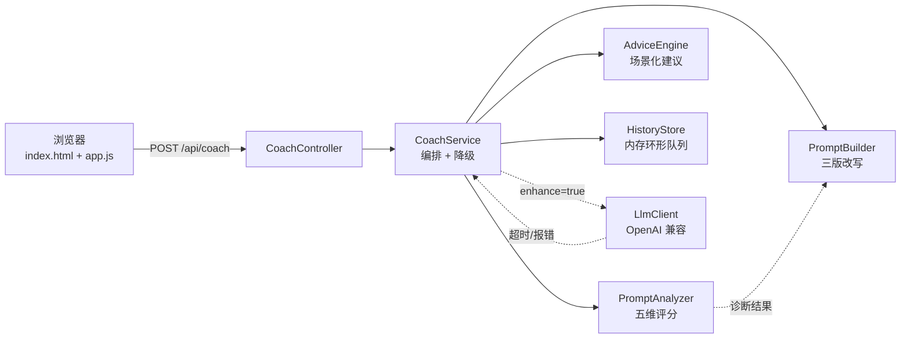

# PromptCoach · AI 提效教练

**把「帮我写个周报」变成 AI 真能交付的指令。**

[](https://openjdk.org/projects/jdk/17/)
[](https://spring.io/projects/spring-boot)
[](#测试)
[](LICENSE)
[](#不配置-api-key-也能用)

> 推送仓库后，把上面的徽章换成你自己的 CI 徽章：
> ``

---

## 这是什么

大多数人用 AI 效率低，不是模型不行，是**需求没写清楚**。

PromptCoach 不替你聊天，它做三件别的东西：

1. **五维诊断**：角色 / 任务 / 背景 / 约束 / 输出格式，逐项打分，并指出「哪一句话缺了什么」。
2. **缺口可视化**：把缺失的信息变成 `『待补充：…』` 占位符，而不是空泛地说「能再详细点吗」。
3. **三版改写**：结构化版、极简版、反问版，直接复制就能用。

**不需要任何 API Key 也能完整运行**——评分和建议全部由本地规则引擎完成，大模型只是可选的「增强」。

---

## 效果

输入一句典型的学生式需求：

```text
帮我写个周报
```

得到：

```text
得分 18 / 100   D 级   覆盖 1/5 个维度

一句话结论：还差 5 项没交代，其中「角色设定」最影响结果质量，建议先补它。

还缺什么
  · 信息量太少：一句话很难让 AI 一次给对
  · 缺角色：没说让 AI 用什么专业身份或视角来做
  · 缺背景：给谁用、为什么做、现在什么状况都没交代
  · 缺约束：字数、风格、边界没提，结果容易跑偏
  · 缺输出格式：不知道要它交一段话、一张表还是一份清单

改写后的提示词（节选）
  # 角色
  『待补充：AI 的专业身份，例如「资深 Java 后端工程师」』

  # 任务
  帮我写个周报

  # 背景
  『待补充：谁会用这份结果、为什么做、现在进行到哪一步』
```

补齐信息后同样的需求能拿到 **94 分 S 级**：

```text
你是资深 Java 后端工程师，请帮我分析这段订单查询代码的性能瓶颈。
背景：我是大三实习生，在做电商订单系统，目前接口 QPS 300，目标 1000，压测工具用 JMeter。
约束：不超过 500 字，语气正式，不要输出完整重写的代码。
输出：用 Markdown 表格列出问题、原因和改法。
```

---

## 核心特性

| 特性 | 说明 |
| --- | --- |
| **五维诊断** | 规则引擎逐维打分，每一分都有「为什么」的证据 |
| **缺口可视化** | 缺失信息显示为占位符，不会替你脑补 |
| **三版改写** | 结构化 / 极简 / 反问，覆盖「直接发」和「先对齐」两种用法 |
| **场景模板库** | 周报、论文润色、代码审查、报错定位、面试准备、学习计划、汇报大纲、求职邮件、技术选型 |
| **零 Key 可跑** | 默认纯本地规则，clone 下来就能演示 |
| **大模型可选增强** | 任意 OpenAI 兼容接口（DeepSeek / OpenAI / 通义 / Kimi），失败自动降级 |
| **可解释、可测试** | 纯函数式的规则实现，25 个单元 + 集成测试锁定行为 |

---

## 快速开始

环境：JDK 17+、Maven 3.8+

```bash
git clone https://github.com/<你的用户名>/prompt-coach.git
cd prompt-coach
mvn spring-boot:run
```

浏览器打开 <http://localhost:8080>，输入一句需求即可。

打包成可执行 jar：

```bash
mvn -DskipTests package
java -jar target/prompt-coach-1.0.0.jar
```

### 不配置 API Key 也能用

默认就是本地规则模式：诊断、改写、建议全部在本地完成，不联网、不花钱、不收集数据。

### 接入大模型（可选）

设置环境变量即可，代码不用改：

| 变量 | 默认值 | 说明 |
| --- | --- | --- |
| `AI_API_KEY` | 空 | 为空则始终使用本地规则引擎 |
| `AI_BASE_URL` | `https://api.deepseek.com/v1` | 任意 OpenAI 兼容地址 |
| `AI_MODEL` | `deepseek-chat` | 模型名 |

几个常用组合：

| 服务商 | `AI_BASE_URL` | `AI_MODEL` |
| --- | --- | --- |
| DeepSeek | `https://api.deepseek.com/v1` | `deepseek-chat` |
| OpenAI | `https://api.openai.com/v1` | `gpt-4o-mini` |
| 通义千问 | `https://dashscope.aliyuncs.com/compatible-mode/v1` | `qwen-plus` |
| Kimi | `https://api.moonshot.cn/v1` | `moonshot-v1-8k` |

```bash
# PowerShell
$env:AI_API_KEY="sk-xxx"; mvn spring-boot:run

# bash
AI_API_KEY=sk-xxx mvn spring-boot:run
```

开启后前端右上角会显示「已连接 deepseek-chat」，勾选「大模型增强」才会调用（不勾选永远走本地，省钱）。

---

## 评分规则

| 维度 | 满分 | 判定依据 |
| --- | --- | --- |
| 角色设定 | 15 | 是否出现「你是 / 作为 / 扮演 / 以…视角」等身份设定 |
| 任务明确 | 25 | 是否有明确动词（写 / 分析 / 重构…）+ 足够长的描述，模糊词会扣分 |
| 背景上下文 | 20 | 是否交代场景、受众（给谁看）、当前现状 |
| 约束条件 | 20 | 字数、语气、边界等限制出现的次数 |
| 输出格式 | 20 | 是否指定表格 / 清单 / 大纲 / 字数等形态 |

等级：`S ≥ 85`，`A ≥ 70`，`B ≥ 55`，`C ≥ 40`，`D < 40`。

规则全部集中在 [`Signals.java`](src/main/java/com/promptcoach/support/Signals.java)，想加词表只改一个文件。

---

## 架构



```text
src/main/java/com/promptcoach
├── PromptCoachApplication.java
├── config/          CoachProperties（环境变量配置）、CoachConfig
├── support/         Signals（信号词表，规则唯一来源）
├── model/           record：请求、诊断、报告、模板、历史
├── service/         PromptAnalyzer / PromptBuilder / AdviceEngine
│                    TemplateLibrary / HistoryStore / CoachService
├── llm/             LlmClient 接口 + OpenAI 兼容实现
└── web/             Controller + 统一异常处理
src/main/resources
├── application.yml
└── static/          index.html / app.js / style.css（零构建）
```

---

## 接口

| 方法 | 路径 | 说明 |
| --- | --- | --- |
| `POST` | `/api/coach` | 诊断 + 改写，body：`{"text": "...", "enhance": false}` |
| `GET` | `/api/templates` | 场景模板库 |
| `GET` | `/api/history?limit=10` | 最近诊断记录 |
| `DELETE` | `/api/history` | 清空记录 |
| `GET` | `/api/meta` | 运行信息（是否已接大模型、模型名） |

```bash
curl -X POST http://localhost:8080/api/coach \
  -H "Content-Type: application/json" \
  -d '{"text":"帮我写个周报","enhance":false}'
```

错误统一返回中文 JSON：

```json
{"error": "bad_request", "message": "请输入你的需求，比如：帮我写个周报"}
```

---

## 测试

```bash
mvn test          # 25 个用例
mvn verify        # 打包 + 测试
```

覆盖点：五维评分边界、模糊词扣分、占位符生成、三种降级路径（没 Key / 接口报错 / 正常增强）、接口 400/404 语义、静态首页可达。

> 仓库里的 `src/test/resources/mockito-extensions/` 是一个兼容性配置：Mockito 默认的 inline mock maker 需要 JVM 动态 attach，在部分受限环境（容器、CI 沙箱）会初始化失败，切换到 subclass mock maker 可以稳定运行。本项目测试本身不使用 Mockito。

---

## 常见问题

**`mvn test` 报 `surefire-junit-platform` 找不到？**

说明本机 Maven 仓库处于离线状态——首次跑测试需要联网下载 surefire 的 JUnit 提供者。先 `mvn -DskipTests package` 打包并运行，联网后再补跑测试即可。

**页面能打开，但勾选「大模型增强」后提示没配置？**

`AI_API_KEY` 没生效。注意环境变量要在**启动应用的那个终端**里设置，改完需要重启进程；Windows 上可用 `$env:AI_API_KEY="sk-xxx"` 后重启。

**能不用 Spring Boot 吗？**

诊断逻辑（`PromptAnalyzer` / `PromptBuilder` / `AdviceEngine`）是纯 Java 类，没有任何框架依赖，可以单独抽出来放进 CLI 或 Android 项目。

---

## 部署

**方式一：直接跑 jar**（最省事）

```bash
mvn -DskipTests package
AI_API_KEY=sk-xxx java -jar target/prompt-coach-1.0.0.jar
```

**方式二：Docker**

```bash
mvn -DskipTests package
docker build -t prompt-coach .
docker run -p 8080:8080 -e AI_API_KEY=sk-xxx prompt-coach
```

**方式三：免费云平台**（Railway / Render / Fly.io）

1. 仓库连上去，构建命令 `mvn -DskipTests package`，启动命令 `java -jar target/prompt-coach-1.0.0.jar`；
2. 在平台的环境变量里加 `AI_API_KEY`（不加也能跑，只是没有增强模式）；
3. 平台通常会自动注入 `PORT`，本项目已支持 `--server.port`，在启动命令后追加 `--server.port=$PORT` 即可。

---

## 设计取舍

写这个工具时刻意做了几个选择，面试时也比较好讲：

- **不把全部逻辑交给大模型**：评分和缺口检测是确定性的规则，离线可跑、可测试、可解释，成本为 0；大模型只做它最擅长的「按结构改写」。
- **用占位符而不是编内容**：模型很容易把缺失信息补得很像真的。`『待补充：…』` 让「不知道」显式可见，这也是这个工具和普通提示词模板的本质区别。
- **降级优先**：没配 Key、超时、接口 500，都必须返回可用结果，而不是把异常抛给用户——`CoachService` 里的 `notice` 字段就是干这个的。
- **不引数据库**：价值在诊断逻辑，不在持久化。`HistoryStore` 换成 JPA 只需要改三个方法。
- **前端零构建**：没有 node_modules、没有打包步骤，`mvn spring-boot:run` 就能看到完整界面，降低别人跑起来的门槛。

---

## 路线图

- [ ] 流式输出（SSE），增强模式边生成边显示
- [ ] 提示词收藏夹 + 导出 Markdown
- [ ] 同一需求多模型对比评分
- [ ] 团队共享模板（需要持久化）

---

## 推送到自己的 GitHub

```bash
git remote add origin https://github.com/<你的用户名>/prompt-coach.git
git branch -M main
git push -u origin main
```

推送后建议做两件事：

1. 把 README 顶部的徽章换成自己的仓库徽章；
2. 在仓库 `Settings → Actions → General` 里确认 Workflow 权限为允许（CI 默认就会跑）。

---

## License

[MIT](LICENSE) © 2026 PromptCoach contributors