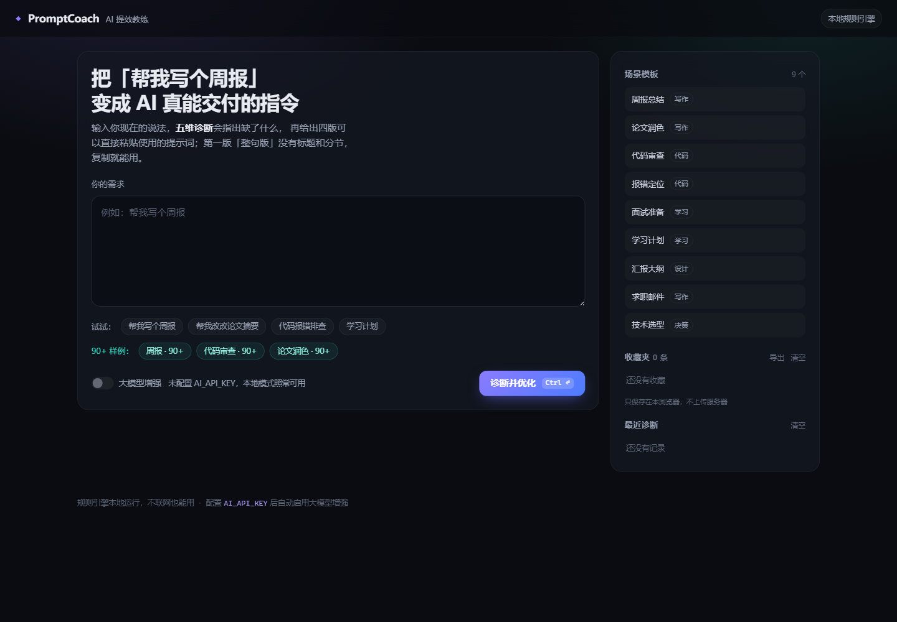
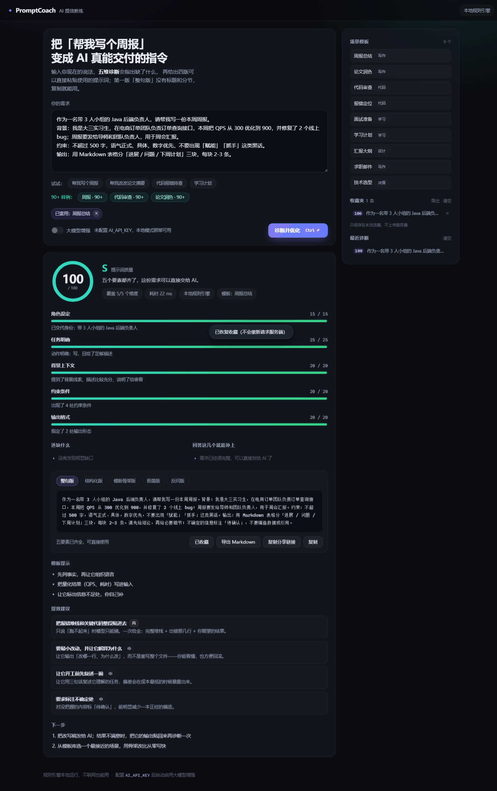
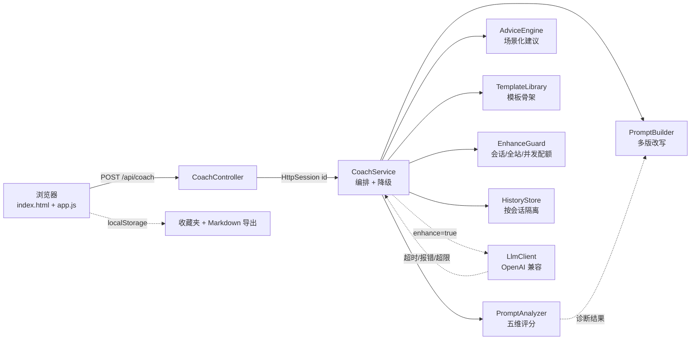

# PromptCoach · AI 提效教练

**把「帮我写个周报」变成 AI 真能交付的指令。**

[](https://openjdk.org/projects/jdk/17/)
[](https://spring.io/projects/spring-boot)
[](#测试)
[](#)
[](LICENSE)
[](#不配置-api-key-也能用)
[](https://github.com/JaneSmith719/prompt-coach/actions/workflows/ci.yml)

---

## 界面

输入一句话，右边是场景模板库和只存在本浏览器的收藏夹；点「诊断并优化」立刻拿到评分、缺口和可复制的改写稿。不知道怎么写满分需求时，直接点「90+ 样例」里的周报、代码审查、论文润色，三个示例实测都是 100 分。

<p align="center">
  
</p>

<p align="center">
  
</p>

<p align="center"><em>「周报总结」90+ 样例 → 100 分 S 级：五维评分、模板提示与「整句版 / 结构化版 / 模板骨架版 / 极简版 / 反问版」</em></p>

---

## 这是什么

大多数人用 AI 效率低，不是模型不行，是**需求没写清楚**。

PromptCoach 不替你聊天，它做三件别的东西：

1. **五维诊断**：角色 / 任务 / 背景 / 约束 / 输出格式，逐项打分，并指出「哪一句话缺了什么」。
2. **缺口可视化**：把缺失的信息变成 `『待补充：…』` 占位符，而不是空泛地说「能再详细点吗」。
3. **多版改写**：整句版、结构化版、极简版、反问版，选模板时再加一版「模板骨架版」，直接复制就能用。其中「整句版」没有标题和分节，是一段连续文字，最适合直接粘进聊天框。

**不需要任何 API Key 也能完整运行**——评分和建议全部由本地规则引擎完成，大模型只是可选的「增强」。

---

## 效果

输入一句典型的学生式需求：

```text
帮我写个周报
```

得到：

```text
得分 18 / 100   D 级   覆盖 1/5 个维度

一句话结论：还差 5 项没交代，其中「角色设定」最影响结果质量，建议先补它。

还缺什么
  · 信息量太少：一句话很难让 AI 一次给对
  · 缺角色：没说让 AI 用什么专业身份或视角来做
  · 缺背景：给谁用、为什么做、现在什么状况都没交代
  · 缺约束：字数、风格、边界没提，结果容易跑偏
  · 缺输出格式：不知道要它交一段话、一张表还是一份清单

改写后的提示词（节选）
  # 角色
  『待补充：AI 的专业身份，例如「资深 Java 后端工程师」』

  # 任务
  帮我写个周报

  # 背景
  『待补充：谁会用这份结果、为什么做、现在进行到哪一步』
```

补齐信息后同样的需求能拿到 **94 分 S 级**：

```text
你是资深 Java 后端工程师，请帮我分析这段订单查询代码的性能瓶颈。
背景：我是大三实习生，在做电商订单系统，目前接口 QPS 300，目标 1000，压测工具用 JMeter。
约束：不超过 500 字，语气正式，不要输出完整重写的代码。
输出：用 Markdown 表格列出问题、原因和改法。
```

---

## 核心特性

| 特性 | 说明 |
| --- | --- |
| **五维诊断** | 规则引擎逐维打分，每一分都有「为什么」的证据 |
| **缺口可视化** | 缺失信息显示为占位符，不会替你脑补 |
| **多版改写** | 整句 / 结构化 / 极简 / 反问四版；套用模板时追加「模板骨架版」；「整句版」为默认首屏，复制即用 |
| **90+ 样例** | 周报、代码审查、论文润色三个五要素齐全的示例，实测均为 100 分，点一下就能看到满分需求长什么样 |
| **场景模板真正生效** | 周报、论文润色、代码审查、报错定位、面试准备、学习计划、汇报大纲、求职邮件、技术选型；骨架和提示会进入报告 |
| **收藏夹 + Markdown 导出** | 报告快照存在浏览器 `localStorage`，刷新不丢，可单条/全部导出 |
| **会话级历史** | 每个浏览器只看自己的最近诊断，换浏览器或清 Cookie 不会串数据 |
| **零 Key 可跑** | 默认纯本地规则，clone 下来就能演示 |
| **分享链接** | 需求编码进 URL，`/?q=…&t=…` 打开即自动诊断并套用模板，服务端零存储 |
| **大模型可选增强** | 任意 OpenAI 兼容接口（DeepSeek / OpenAI / 通义 / Kimi），失败自动降级 |
| **增强配额** | 单会话每小时 10 次、全站每小时 200 次、并发 2，保护公开实例的 Key |
| **可解释、可测试** | 纯函数式的规则实现，42 个单元 + 集成测试锁定行为 |

### 收藏夹与历史记录

- **收藏夹**：结果区点「收藏」保存完整报告快照；侧栏可恢复、删除、导出全部。数据只在本浏览器的 `localStorage`，**不上传服务器**；换设备/清浏览器数据会丢，所以提供 Markdown 导出兜底。
- **历史记录**：按 `HttpSession`（Cookie `PC_SESSION`）隔离，只保留最近 50 条/会话；Cookie 被禁用时历史为空，但诊断照常可用。历史只在内存里，服务重启即清空。

### 增强配额

配置了 `AI_API_KEY` 的公开实例需要成本保护。默认限制：

| 限制 | 默认 | 环境变量 |
| --- | --- | --- |
| 单会话每小时增强次数 | 10 | `COACH_ENHANCE_PER_SESSION_PER_HOUR` |
| 全站每小时增强次数 | 200 | `COACH_ENHANCE_GLOBAL_PER_HOUR` |
| 全站并发增强数 | 2 | `COACH_ENHANCE_MAX_CONCURRENT` |

超限时不会报 429/500，而是**自动降级为本地规则结果**并在报告里说明原因。`0` 表示关闭对应限制。

### 分享链接是怎么工作的

点结果区的「复制分享链接」，得到形如 `http://localhost:8080/?q=5biu5oiR5YaZ5Liq5ZGo5oql&t=weekly-report` 的地址，
别人打开就自动套用模板并跑一遍同样的诊断。

- 需求用 Base64URL 编码在 URL 里，**服务端不保存任何内容**，也没有新增接口；
- 如果当前套用了模板，链接会额外带 `t=模板 id`，打开后自动恢复模板；
- 超过 600 字会提示「链接可能被聊天工具截断」，而不是悄悄生成一个坏链接；
- 链接损坏时页面给提示、不白屏。

---

## 快速开始

环境：JDK 17+、Maven 3.8+

```bash
git clone https://github.com/JaneSmith719/prompt-coach.git
cd prompt-coach
mvn spring-boot:run
```

浏览器打开 <http://localhost:8080>，输入一句需求即可。

打包成可执行 jar：

```bash
mvn -DskipTests package
java -jar target/prompt-coach-1.2.0.jar
```

### 不配置 API Key 也能用

默认就是本地规则模式：诊断、改写、建议全部在本地完成，不联网、不花钱、不收集数据。

### 接入大模型（可选）

设置环境变量即可，代码不用改：

| 变量 | 默认值 | 说明 |
| --- | --- | --- |
| `AI_API_KEY` | 空 | 为空则始终使用本地规则引擎 |
| `AI_BASE_URL` | `https://api.deepseek.com/v1` | 任意 OpenAI 兼容地址 |
| `AI_MODEL` | `deepseek-chat` | 模型名 |
| `COACH_ENHANCE_PER_SESSION_PER_HOUR` | `10` | 单会话每小时增强上限，0 关闭 |
| `COACH_ENHANCE_GLOBAL_PER_HOUR` | `200` | 全站每小时增强上限，0 关闭 |
| `COACH_ENHANCE_MAX_CONCURRENT` | `2` | 全站并发增强上限，0 关闭 |

几个常用组合：

| 服务商 | `AI_BASE_URL` | `AI_MODEL` |
| --- | --- | --- |
| DeepSeek | `https://api.deepseek.com/v1` | `deepseek-chat` |
| OpenAI | `https://api.openai.com/v1` | `gpt-4o-mini` |
| 通义千问 | `https://dashscope.aliyuncs.com/compatible-mode/v1` | `qwen-plus` |
| Kimi | `https://api.moonshot.cn/v1` | `moonshot-v1-8k` |

```bash
# PowerShell
$env:AI_API_KEY="sk-xxx"; mvn spring-boot:run

# bash
AI_API_KEY=sk-xxx mvn spring-boot:run
```

开启后前端右上角会显示「已连接 deepseek-chat」，勾选「大模型增强」才会调用（不勾选永远走本地，省钱）。增强按钮旁边会显示每小时配额；超限自动降级，不会中断诊断。

---

## 评分规则

| 维度 | 满分 | 判定依据 |
| --- | --- | --- |
| 角色设定 | 15 | 是否出现「你是 / 作为 / 扮演 / 以…视角」等身份设定 |
| 任务明确 | 25 | 是否有明确动词（写 / 分析 / 重构…）+ 足够长的描述，模糊词会扣分 |
| 背景上下文 | 20 | 是否交代场景、受众（给谁看）、当前现状 |
| 约束条件 | 20 | 字数、语气、边界等限制出现的次数 |
| 输出格式 | 20 | 是否指定表格 / 清单 / 大纲 / 字数等形态 |

等级：`S ≥ 85`，`A ≥ 70`，`B ≥ 55`，`C ≥ 40`，`D < 40`。

规则全部集中在 [`Signals.java`](src/main/java/com/promptcoach/support/Signals.java)，想加词表只改一个文件。

---

## 架构



```text
src/main/java/com/promptcoach
├── PromptCoachApplication.java
├── config/          CoachProperties（环境变量配置）、CoachConfig
├── support/         Signals（信号词表，规则唯一来源）
├── model/           record：请求、诊断、报告、模板、历史
├── service/         PromptAnalyzer / PromptBuilder / AdviceEngine
│                    TemplateLibrary / HistoryStore / EnhanceGuard / CoachService
├── llm/             LlmClient 接口 + OpenAI 兼容实现
└── web/             Controller + 统一异常处理
src/main/resources
├── application.yml
└── static/          index.html / app.js / style.css（零构建）
```

---

## 接口

| 方法 | 路径 | 说明 |
| --- | --- | --- |
| `POST` | `/api/coach` | 诊断 + 改写，body：`{"text": "...", "enhance": false, "templateId": "weekly-report"}`；`templateId` 可省略 |
| `GET` | `/api/templates` | 场景模板库 |
| `GET` | `/api/history?limit=10` | **当前浏览器会话**的最近诊断记录 |
| `DELETE` | `/api/history` | 清空**当前会话**的记录 |
| `GET` | `/api/meta` | 运行信息（版本、是否已接大模型、增强配额） |

```bash
curl -X POST http://localhost:8080/api/coach \
  -H "Content-Type: application/json" \
  -d '{"text":"帮我写个周报","enhance":false,"templateId":"weekly-report"}'
```

历史记录依赖 Cookie `PC_SESSION`；用 `curl` 测试时想保留历史，需要加 `-c cookies.txt -b cookies.txt`。

错误统一返回中文 JSON：

```json
{"error": "bad_request", "message": "请输入你的需求，比如：帮我写个周报"}
```

---

## 测试

```bash
mvn test          # 42 个用例
mvn verify        # 打包 + 测试
node --check src/main/resources/static/app.js   # 前端语法检查
```

覆盖点：五维评分边界、模糊词扣分、占位符生成、整句版无标题输出、90+ 样例分数下限、模板骨架、三种降级路径（没 Key / 接口报错 / 配额超限）、会话历史隔离与 LRU、增强配额窗口/并发、接口 400/404 语义、静态首页可达。

> 仓库里的 `src/test/resources/mockito-extensions/` 是一个兼容性配置：Mockito 默认的 inline mock maker 需要 JVM 动态 attach，在部分受限环境（容器、CI 沙箱）会初始化失败，切换到 subclass mock maker 可以稳定运行。本项目测试本身不使用 Mockito。

---

## 常见问题

**`mvn test` 报 `surefire-junit-platform` 找不到？**

说明本机 Maven 仓库处于离线状态——首次跑测试需要联网下载 surefire 的 JUnit 提供者。先 `mvn -DskipTests package` 打包并运行，联网后再补跑测试即可。

**页面能打开，但勾选「大模型增强」后提示没配置？**

`AI_API_KEY` 没生效。注意环境变量要在**启动应用的那个终端**里设置，改完需要重启进程；Windows 上可用 `$env:AI_API_KEY="sk-xxx"` 后重启。

**换个浏览器就看不到历史记录了？**

这是 v1.1 的预期行为：历史按 Cookie `PC_SESSION` 隔离，只存在当前实例内存里。换浏览器、清 Cookie、服务重启都会丢；诊断功能不受影响。需要长期保留请用「收藏 + 导出 Markdown」。

**收藏夹会同步到其他设备吗？**

不会。收藏只写在当前浏览器的 `localStorage`，服务端没有收藏接口；换设备请用「导出」/「导出全部」生成 Markdown 再带走。

**增强次数为什么会被限制？**

公开实例的 `AI_API_KEY` 是共享成本。默认单会话每小时 10 次、全站每小时 200 次、并发 2；超限自动降级为本地规则并在报告里提示，不会报错。可用环境变量调整，`0` 关闭对应限制。

**能不用 Spring Boot 吗？**

诊断逻辑（`PromptAnalyzer` / `PromptBuilder` / `AdviceEngine`）是纯 Java 类，没有任何框架依赖，可以单独抽出来放进 CLI 或 Android 项目。

---

## 部署

**方式一：直接跑 jar**（最省事）

```bash
mvn -DskipTests package
AI_API_KEY=sk-xxx java -jar target/prompt-coach-1.2.0.jar
```

**方式二：Docker**

```bash
mvn -DskipTests package
docker build -t prompt-coach .
docker run -p 8080:8080 -e AI_API_KEY=sk-xxx prompt-coach
```

**方式三：免费云平台**（Railway / Render / Fly.io）

1. 仓库连上去，构建命令 `mvn -DskipTests package`，启动命令 `java -jar target/prompt-coach-1.2.0.jar`；
2. 在平台的环境变量里加 `AI_API_KEY`（不加也能跑，只是没有增强模式）；建议同时设置增强配额，保护共享 Key；
3. 平台通常会自动注入 `PORT`，本项目已支持 `--server.port`，在启动命令后追加 `--server.port=$PORT` 即可；
4. 免费实例休眠/重启会清空内存历史；收藏夹在用户浏览器里，不受影响。多实例部署时历史不共享，本版按单实例设计。

---

## 设计取舍

写这个工具时刻意做了几个选择：

- **不把全部逻辑交给大模型**：评分和缺口检测是确定性的规则，离线可跑、可测试、可解释，成本为 0；大模型只做它最擅长的「按结构改写」。
- **用占位符而不是编内容**：模型很容易把缺失信息补得很像真的。`『待补充：…』` 让「不知道」显式可见，这也是这个工具和普通提示词模板的本质区别。
- **降级优先**：没配 Key、超时、接口 500、增强配额超限，都必须返回可用结果，而不是把异常抛给用户——`CoachService` 里的 `notice` 字段就是干这个的。
- **历史按会话隔离，而不是全局共享**：公开 Demo 不能把 A 的输入展示给 B。用 `HttpSession` + 内存 LRU 实现，不引数据库；代价是重启/换浏览器会丢，适合“最近几条”的定位。
- **收藏放浏览器，不放服务端**：收藏是私人数据，放 `localStorage` 既省掉账号/数据库，也避免公开实例上的隐私问题；用 Markdown 导出解决跨设备/清缓存。
- **公开实例必须有配额**：共享 `AI_API_KEY` 的 Demo 如果不限流，迟早被刷爆。选择“超限降级”而不是 429，是为了让用户始终拿到结果。
- **不引数据库**：价值在诊断逻辑，不在持久化。历史、收藏都不需要后端存储；真要做团队共享再上数据库。
- **前端零构建**：没有 node_modules、没有打包步骤，`mvn spring-boot:run` 就能看到完整界面，降低别人跑起来的门槛。

---

## 路线图

- [x] v1.1：会话级历史、增强配额、模板骨架生效、收藏夹 + Markdown 导出
- [ ] v1.2：流式输出（SSE），增强模式边生成边显示
- [ ] v1.2：同一需求多模型对比评分
- [ ] v1.3：团队共享模板（需要持久化 + 身份体系）

---

## 发布与维护

仓库地址：<https://github.com/JaneSmith719/prompt-coach>

变更记录见 [CHANGELOG.md](CHANGELOG.md)，发布前的手动检查清单见 [docs/manual-test.md](docs/manual-test.md)。

---

## License

[MIT](LICENSE) © 2026 xiezhiwei
